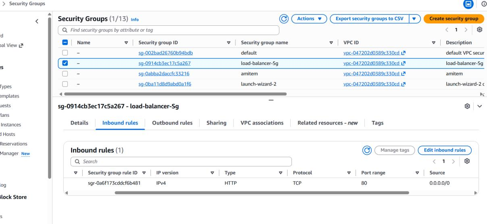
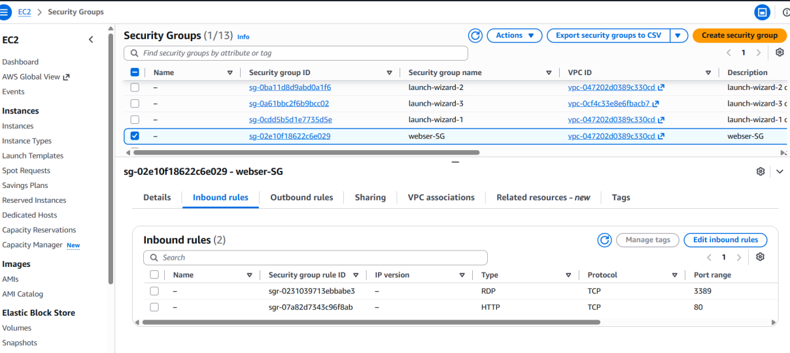
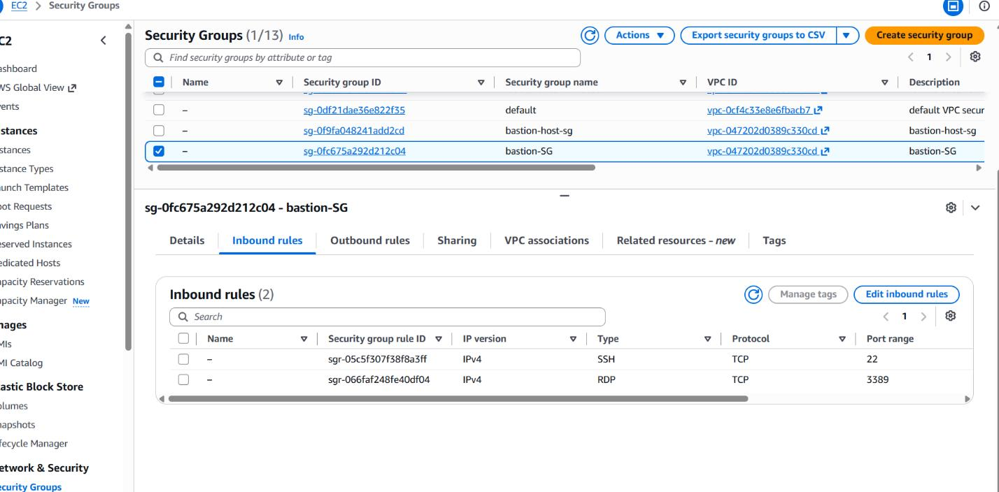

# AWS Secure Three-Tier Web Application Deployment

<p align="center">
  <strong>A secure, highly available three-tier web application on AWS, built by hand and documented with evidence.</strong>
</p>

<p align="center">
  
  
  
  
  
</p>

## Overview

This project deploys a Windows/IIS web application across a segmented AWS network and puts security controls at every layer: a custom VPC with public, private-web and private-database subnets, an internet-facing Application Load Balancer protected by AWS WAF, an Auto Scaling Group built from a custom AMI, a Multi-AZ RDS for MySQL database, IAM roles instead of stored credentials, Secrets Manager for database credentials, and CloudWatch, SNS and CloudTrail for monitoring and audit.

It was built manually in the AWS Console to learn how the pieces fit together, then torn down after documentation to avoid ongoing costs. Every claim below is backed by a screenshot in [`docs/screenshots`](docs/screenshots), and the places where the build falls short of production standards are listed openly in [Known gaps](#known-gaps-and-hardening-roadmap).

## Architecture


> The diagram is a logical view. For exact CIDRs, Auto Scaling limits and IAM policies, use the **Deployed configuration** tables below, which come straight from the console screenshots.

| Layer | What runs there | Why |
|---|---|---|
| Public | ALB, bastion host, NAT gateway | The only components that need an internet-facing address |
| Private web | Windows/IIS instances launched by an Auto Scaling Group | Reachable only from the ALB (HTTP) and the bastion (RDP) |
| Private database | RDS for MySQL | Reachable only from the web tier on TCP 3306, with no public endpoint |
| Cross-cutting | WAF, IAM, Secrets Manager, KMS, CloudWatch, SNS, CloudTrail, S3 | Protection, identity, secrets, encryption, monitoring, audit |

## Table of contents

- [Deployed configuration](#deployed-configuration)
- [Traffic flow](#traffic-flow)
- [Security controls](#security-controls)
- [Known gaps and hardening roadmap](#known-gaps-and-hardening-roadmap)
- [Evidence](#evidence)
- [Reproducing this build](#reproducing-this-build)
- [Repository layout](#repository-layout)
- [Lessons learned](#lessons-learned)
- [Author](#author)

## Deployed configuration

### Network

VPC `websec`, CIDR `10.0.0.0/16`, region `ap-south-1` (Mumbai).

| Subnet | CIDR | AZ | Tier | Holds |
|---|---|---|---|---|
| `pubsub-bastion` | 10.0.3.0/28 | ap-south-1a | Public | Bastion host, ALB node |
| `publicsub-natgateway` | 10.0.5.0/24 | ap-south-1c | Public | NAT gateway, ALB node |
| `privatesub-ser-1` | 10.0.1.0/24 | ap-south-1a | Private web | IIS web server |
| `privatesub-ser-2` | 10.0.2.0/24 | ap-south-1c | Private web | IIS web server |
| `privatesub-rdsmysql` | 10.0.4.0/28 | ap-south-1a | Private DB | RDS (primary subnet) |
| `websec-rds-2` | 10.0.6.0/28 | ap-south-1b | Private DB | RDS (second subnet for the Multi-AZ subnet group) |

| Route table | Associated with | Default route |
|---|---|---|
| `natgateway-and-bastionhost` | Both public subnets | `0.0.0.0/0` → Internet Gateway `websec-IGW` |
| `webser1-and-2` | Both private web subnets | `0.0.0.0/0` → NAT gateway `natgatewayforwebsec` |
| `RDS-mysql` | `privatesub-rdsmysql` | Local only, no internet path |

### Security groups

| Security group | Inbound |
|---|---|
| `load-balancer-Sg` | TCP 80 from `0.0.0.0/0` |
| `webser-SG` | TCP 80 and TCP 3389 (sources: the ALB and bastion security groups) |
| `bastion-SG` | TCP 3389 (RDP) and TCP 22 (SSH) (see [known gaps](#known-gaps-and-hardening-roadmap)) |
| RDS security group | TCP 3306 from the web security group |

The screenshots don't show the Source column for the web and bastion groups, and there is no RDS security group screenshot, so those sources are as documented in the [report](docs/reports/AWS_Secure_Web_Application_Deployment.pdf).

### Compute and load balancing

| Component | Configuration |
|---|---|
| Custom AMI | `project-web-ami`, Windows Server 2019 with IIS, built from a temporary builder instance |
| Launch template | `template-for-websec`, `t3.micro`, custom AMI, IAM instance profile attached |
| Auto Scaling Group | `ASG-for-websec1`, desired capacity 2, scaling limits 1 to 2, across both private web subnets |
| Load balancer | `LBforwebsec`, internet-facing ALB, HTTP:80, two AZs (1a and 1c) |
| Target group | `tgforwebsec`, HTTP:80, instance targets, 2 of 2 healthy |
| Bastion | `bastionhost`, public IP, the only entry point for administration |

### Identity, secrets and encryption

| Item | Configuration |
|---|---|
| EC2 instance role | `iam-cloudwatch` with `CloudWatchAgentServerPolicy`, `SecretsManagerReadWrite`, `AWSSecretsManagerClientReadOnlyAccess` and `AWSTransformSecretsManagerConnector…` |
| Secret | `secret-manager-forwebsec`, encrypted with `aws/secretsmanager` |
| RDS encryption | AWS-managed key `aws/rds` (documented in the [report](docs/reports/AWS_Secure_Web_Application_Deployment.pdf)) |
| WAF | Web ACL `waf-for-websec` (20 rules) associated with the ALB |

### Monitoring and audit

| Item | Configuration |
|---|---|
| CloudWatch alarm | `cloudwatch-websec`: EC2 `CPUUtilization >= 80%` |
| SNS | Topic `snsforwebsec`, confirmed email subscription |
| CloudTrail | `websec-trails`: multi-region, log file validation enabled, delivered to S3 |

## Traffic flow

**Application requests**

1. A client sends an HTTP request to the ALB's DNS name.
2. AWS WAF inspects the request through its association with the ALB.
3. The ALB forwards allowed requests to the target group.
4. A healthy IIS instance in a private subnet handles the request.
5. If needed, the instance fetches database credentials from Secrets Manager using its IAM role, then queries RDS on TCP 3306.
6. The response returns along the same path.

**Administration**

1. An administrator connects by RDP to the bastion host, using its public IP.
2. From the bastion, the administrator connects by RDP to a private web server.

**Outbound traffic from private instances** (updates, AWS API calls) leaves through the NAT gateway. Nothing in the private tiers has a public IP.

## Security controls

| Control | Implementation |
|---|---|
| Network segmentation | Three tiers in separate subnets, with route tables that give the database tier no internet path |
| Defense in depth | WAF, then ALB security group, then web security group, then database security group |
| No stored credentials | EC2 instance role plus Secrets Manager, with no access keys on instances |
| Private database | RDS in private subnets, reachable only from the web tier |
| Encryption at rest | RDS (`aws/rds`) and Secrets Manager (`aws/secretsmanager`) |
| Availability | Two-AZ web tier behind an ALB, Auto Scaling, Multi-AZ RDS |
| Audit | Multi-region CloudTrail with log file validation |
| Alerting | CloudWatch CPU alarm to SNS email |

## Known gaps and hardening roadmap

This was a learning build, and a security project should be honest about what it hasn't done yet. Findings below come from reviewing the console screenshots. Step-by-step fixes, including a least-privilege IAM policy, are in [`docs/hardening.md`](docs/hardening.md).

| Priority | Gap | Fix |
|---|---|---|
| High | The ALB serves **HTTP only**, so traffic is unencrypted in transit | Add an ACM certificate and an HTTPS listener, then redirect 80 to 443 |
| High | The instance role has `SecretsManagerReadWrite` plus two other Secrets Manager policies, which is far broader than reading one secret | Replace with an inline policy allowing only `secretsmanager:GetSecretValue` on this secret's ARN |
| High | `bastion-SG` has an SSH (22) rule as well as RDP, and the rule sources aren't visible in the screenshots | Confirm both are limited to a single admin IP, and remove SSH on a Windows bastion |
| Medium | CloudTrail logs aren't encrypted with KMS, aren't sent to CloudWatch Logs, and SNS delivery is disabled | Enable SSE-KMS, add a CloudWatch Logs log group, and alarm on key events |
| Medium | WAF logging is not enabled | Enable logging to S3 or CloudWatch Logs |
| Medium | A single NAT gateway (AZ 1c) is a single point of failure for private egress | Add a NAT gateway per AZ with matching route tables |
| Medium | RDP and a bastion are an old pattern | Move to Systems Manager Session Manager and close port 3389 |
| Low | `websec-rds-2` uses the VPC main route table, not the local-only `RDS-mysql` table | Associate it with `RDS-mysql` and confirm the main table has no internet route |
| Low | Auto Scaling min is 1 while the web tier is described as always running two instances | Set min to 2 if two-AZ redundancy is required |
| Low | The AMI builder instance (`projct-web-ami`) is still running in the EC2 screenshot | Terminate it once the AMI exists, as the diagram shows |
| Low | No VPC Flow Logs, GuardDuty or AWS Config | Enable all three |
| Low | Built by hand in the console | Recreate in Terraform or CloudFormation for repeatability |

## Evidence

The screenshots below are grouped by area. Account IDs, email addresses and public IPs have been redacted.

<details>
<summary><strong>Networking</strong></summary>

**VPC**


**Subnets**


**Route tables**


**Internet gateway**


**NAT gateway**


</details>

<details>
<summary><strong>Compute and load balancing</strong></summary>

**EC2 instances**


**Custom AMI**


**Launch template**


**Auto Scaling group**


**Application Load Balancer**


**Target group**


</details>

<details>
<summary><strong>Security</strong></summary>

**Security group: load balancer**


**Security group: web tier**


**Security group: bastion**


**IAM role**


**AWS WAF**


**Secrets Manager**


</details>

<details>
<summary><strong>Monitoring and audit</strong></summary>

**CloudWatch**


**SNS**


**CloudTrail**


</details>

The full write-up, with the AMI build, IIS setup and the remaining screenshots, is in the [project report (PDF)](docs/reports/AWS_Secure_Web_Application_Deployment.pdf).

## Reproducing this build

[`docs/deployment-guide.md`](docs/deployment-guide.md) lists the build order, validation checks and teardown steps.

> **Cost warning:** a NAT gateway, an ALB and a Multi-AZ RDS instance all bill by the hour. Tear the environment down when you finish.

## Repository layout

```
.
├── README.md
├── LICENSE
├── docs/
│   ├── architecture/architecture.png
│   ├── deployment-guide.md
│   ├── hardening.md
│   ├── reports/AWS_Secure_Web_Application_Deployment.pdf
│   └── screenshots/
│       ├── networking/
│       ├── compute/
│       ├── security/
│       └── monitoring/
└── .gitignore
```

## Lessons learned

- A subnet is only "public" or "private" because of its route table, and getting associations right matters more than naming.
- Security groups that reference other security groups (not CIDRs) keep each tier reachable only from the tier above it.
- Managed IAM policies are convenient but broad, and trimming them to least privilege is a separate, deliberate step.
- Auditing your own build against the diagram and the console turns up mismatches, which is why this README lists its gaps.

## Author

**Naman Gaur**, M.Sc. Cybersecurity & Digital Forensics, focused on cloud security, IAM and network security.

[LinkedIn](https://www.linkedin.com/in/naman-gaur-21322b294/) · [GitHub](https://github.com/ngaur10)

Released under the [MIT License](LICENSE).
