# AWS Secure Three-Tier Web Application Deployment

&#x20; <strong>A Secure, Scalable and Highly Available AWS Architecture</strong>

&#x20; 

&#x20; 

&#x20; 

&#x20; 

&#x20; 

&#x20; 

---

## Overview

This project demonstrates the design and implementation of a secure,

scalable, and highly available three-tier web application architecture

on Amazon Web Services (AWS).

The infrastructure follows key AWS Well-Architected security principles,

including:

- Network segmentation

- Least-privilege access control

- Defense in depth

- Secure credential management

- Encryption at rest

- Centralized logging and monitoring

- High availability and fault tolerance

The architecture uses a custom Amazon VPC with public and private

subnets, an Application Load Balancer, Windows/IIS EC2 instances,

Auto Scaling, Amazon RDS for MySQL, AWS WAF, IAM roles,

AWS Secrets Manager, AWS KMS, CloudTrail, and CloudWatch.

## Architecture

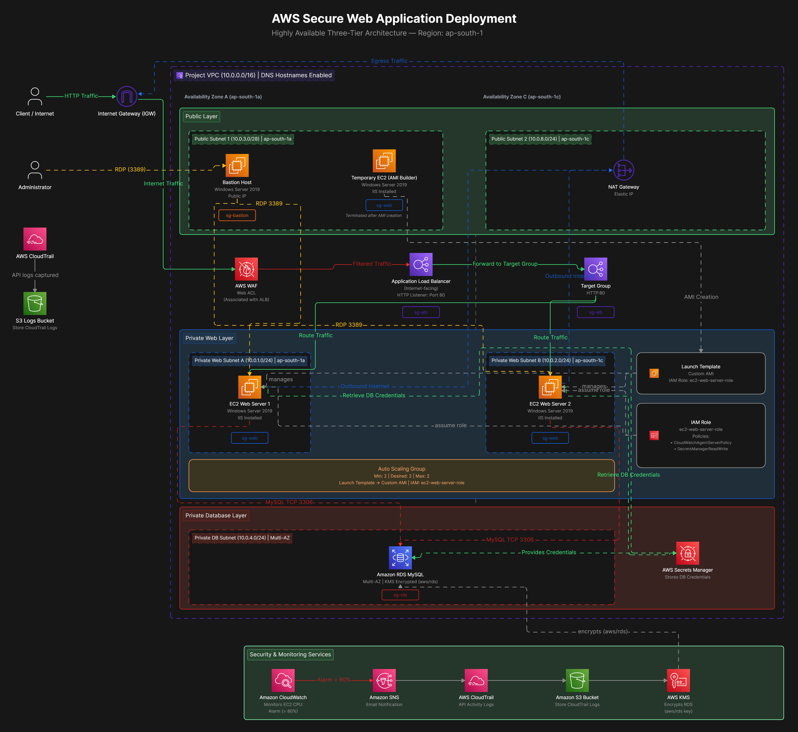

### Architecture Highlights

| Component | Implementation |

|---|---|

| Networking | Custom VPC with public and private subnets |

| Availability | Two Availability Zones |

| Load Balancing | Application Load Balancer |

| Compute | Windows Server EC2 with IIS |

| Scalability | Auto Scaling Group |

| Database | Amazon RDS for MySQL |

| Web Protection | AWS WAF |

| Identity \& Access | IAM Roles and Security Groups |

| Secrets Management | AWS Secrets Manager |

| Encryption | AWS KMS |

| Monitoring | Amazon CloudWatch |

| Audit Logging | AWS CloudTrail |

| Notifications | Amazon SNS |

---

## Table of Contents

- [Project Objectives](#project-objectives)

- [AWS Services Used](#aws-services-used)

- [Network Architecture](#network-architecture)

- [Security Implementation](#security-implementation)

- [Traffic Flow](#traffic-flow)

- [Monitoring and Logging](#monitoring-and-logging)

- [Challenges Faced](#challenges-faced)

- [Skills Demonstrated](#skills-demonstrated)

- [Future Improvements](#future-improvements)

- [Project Documentation](#project-documentation)

- [Author](#author)

---

## Project Objectives

- Design a secure AWS infrastructure.

- Implement a highly available web application architecture.

- Isolate workloads using public and private subnets.

- Protect web applications against malicious traffic.

- Implement IAM roles instead of hardcoded AWS credentials.

- Secure database communication.

- Encrypt sensitive data at rest.

- Implement infrastructure monitoring and audit logging.

- Apply least-privilege access principles.

- Demonstrate practical cloud security engineering concepts.

---

## AWS Services Used

| Category | AWS Services |

|---|---|

| Networking | VPC, Internet Gateway, NAT Gateway, Route Tables, Network ACLs |

| Compute | EC2, Launch Templates, Auto Scaling Groups |

| Load Balancing | Application Load Balancer, Target Groups |

| Security | IAM, Security Groups, AWS WAF, AWS KMS |

| Secrets Management | AWS Secrets Manager |

| Database | Amazon RDS for MySQL |

| Monitoring | CloudWatch, CloudWatch Alarms |

| Logging | CloudTrail, Amazon S3 |

| Notifications | Amazon SNS |

---

## Network Architecture

### 1. Virtual Private Cloud

A custom VPC was configured with the following CIDR block:

`10.0.0.0/16`

The VPC spans two Availability Zones:

- ap-south-1a

- ap-south-1c

DNS hostnames were enabled to support internal resource communication.

### 2. Subnet Design

The infrastructure separates workloads into different network tiers.

| Subnet | Purpose |

|---|---|

| Public Subnets | Application Load Balancer, Bastion Host and NAT Gateway |

| Private Web Subnets | Windows/IIS EC2 instances |

| Private Database Subnets | Amazon RDS for MySQL |

### 3. Route Tables

| Route Table | Destination | Target |

|---|---|---|

| Public | 0.0.0.0/0 | Internet Gateway |

| Private Web | 0.0.0.0/0 | NAT Gateway |

| Private Database | Local route only | VPC |

### Networking Evidence

**VPC Configuration**

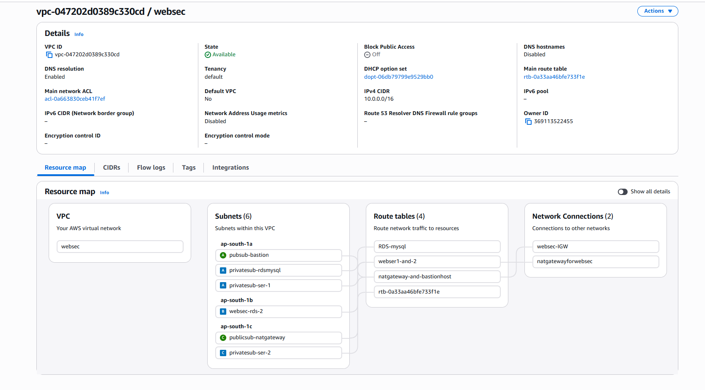

**Subnet Configuration**

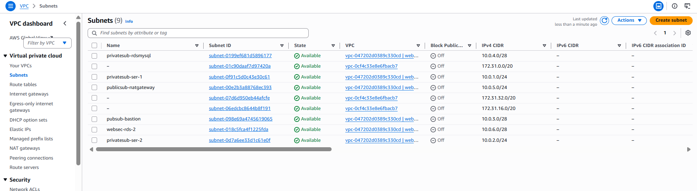

**Internet Gateway**

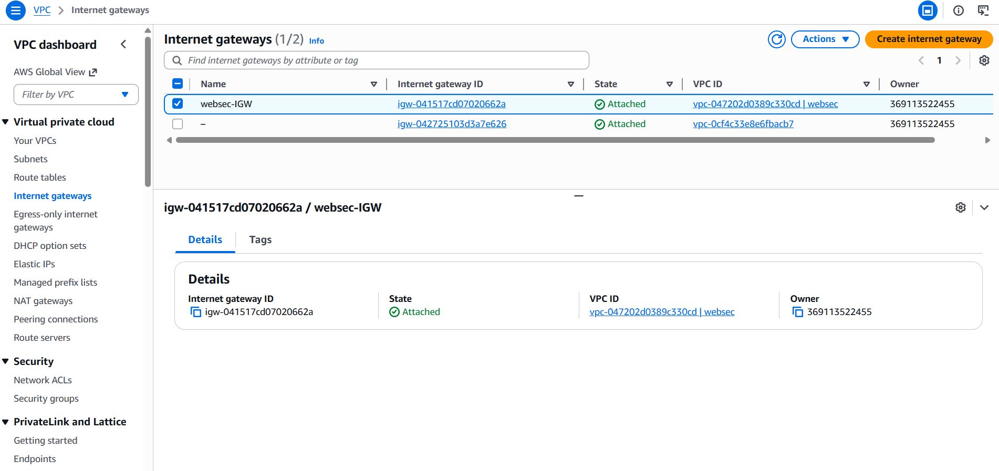

**NAT Gateway**

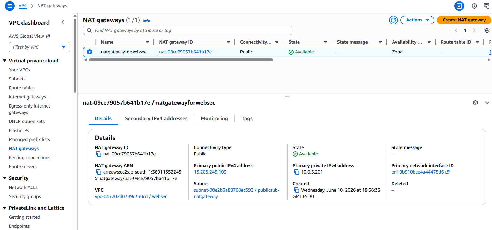

**Route Tables**

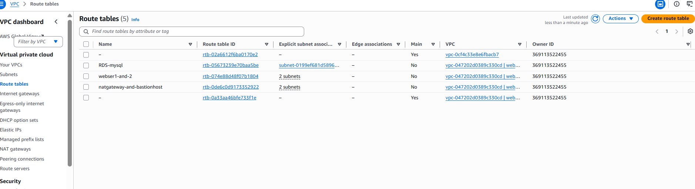

---

## Compute Architecture

### Amazon EC2

Windows Server EC2 instances were deployed with IIS to host the web application.

The architecture includes:

- Bastion Host for administrative access.

- Private EC2 web servers.

- Custom Windows Server AMI.

- Launch Template for consistent instance configuration.

- Auto Scaling Group for instance availability and elasticity.

### Application Load Balancer

An internet-facing Application Load Balancer distributes incoming application traffic across registered EC2 instances.

### Auto Scaling

The Auto Scaling Group maintains the desired number of web server instances.

### Compute Evidence

**EC2 Instances**

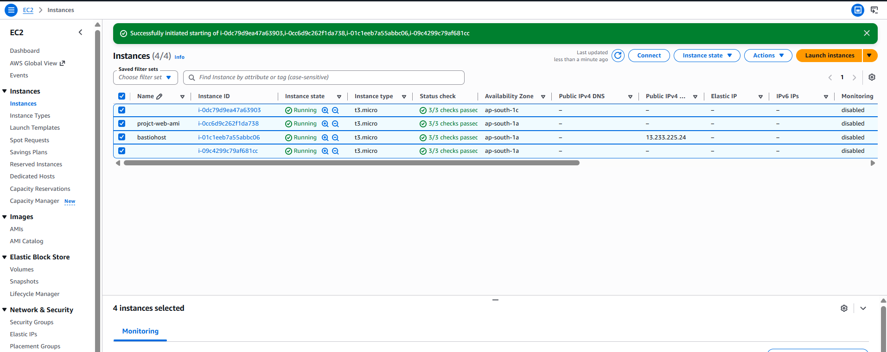

**Custom AMI**

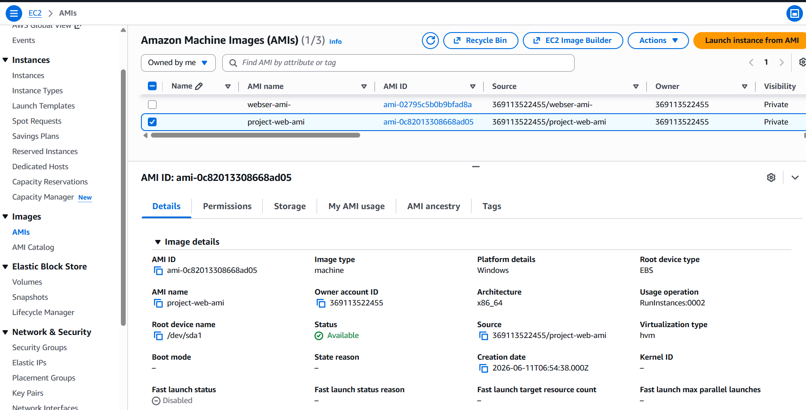

**Launch Template**

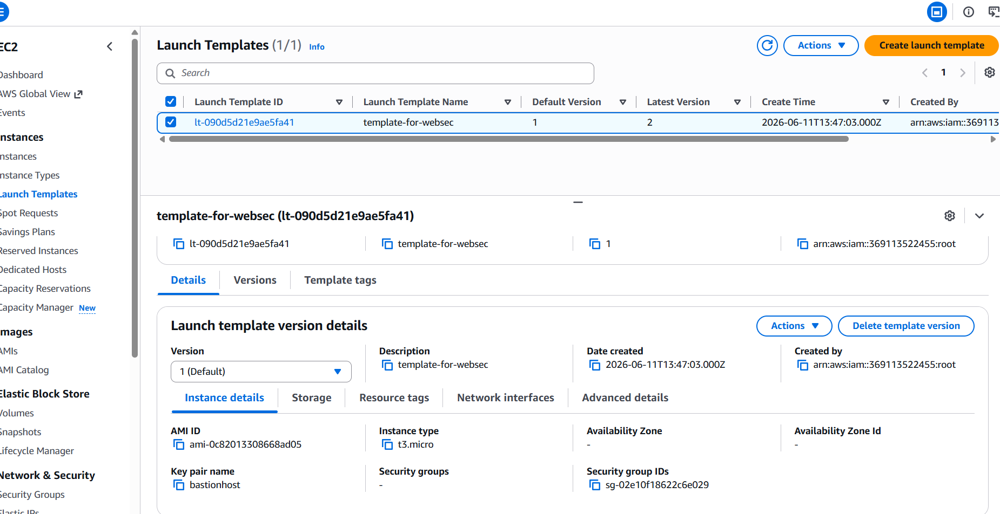

**Auto Scaling Group**

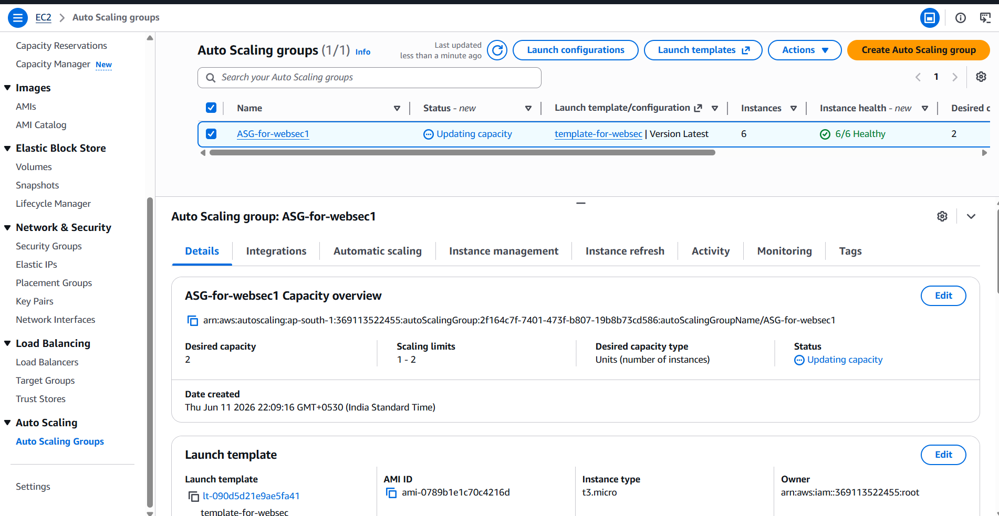

**Application Load Balancer**

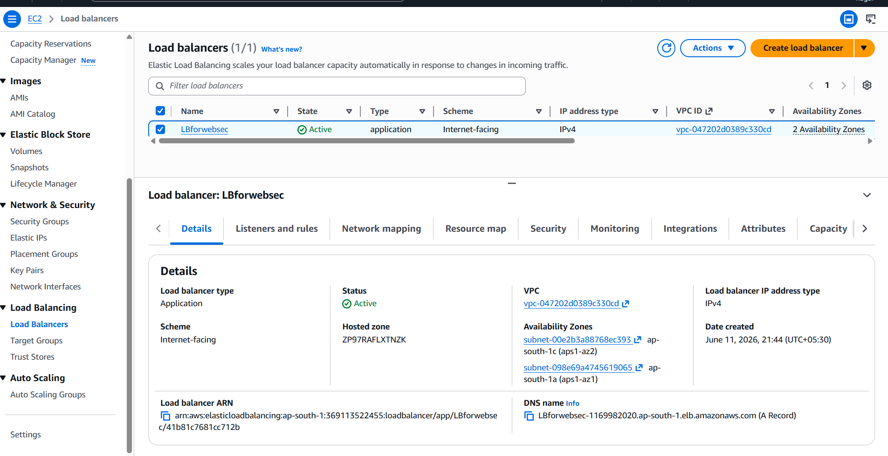

**Target Group**

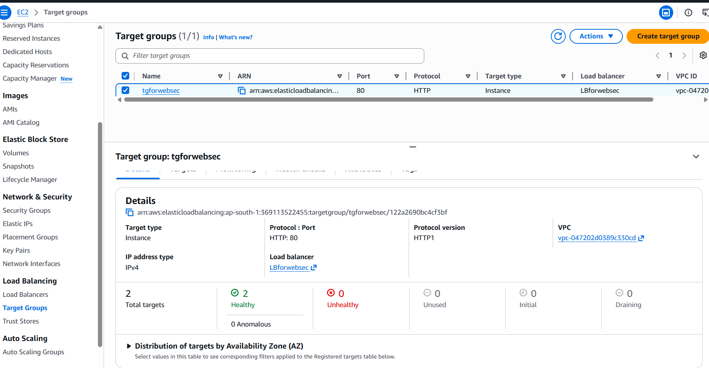

---

## Security Implementation

Security was implemented through multiple layers of access control,

network restrictions, credential protection, and encryption.

### 1. Security Groups

Security Groups restrict communication between infrastructure components.

| Security Group | Inbound Rules |

|---|---|

| sg-bastion | TCP 3389 from administrator IP |

| sg-alb | TCP 80 from 0.0.0.0/0 |

| sg-web | TCP 80 from ALB Security Group; TCP 3389 from Bastion |

| sg-rds | TCP 3306 from Web Server Security Group |

### 2. IAM Roles

A dedicated IAM role was configured for EC2 web servers:

`ec2-web-server-role`

The role uses:

- CloudWatchAgentServerPolicy

- SecretsManagerReadWrite

The instance role avoids storing long-lived AWS access keys on EC2.

**Security consideration:** SecretsManagerReadWrite is broader than

necessary for retrieving one database secret. A production deployment

should replace it with a narrowly scoped secretsmanager:GetSecretValue

permission for the required secret.

### 3. AWS Secrets Manager

AWS Secrets Manager stores database credentials securely instead of

embedding them directly into application configuration files.

### 4. AWS WAF

AWS WAF protects the web application by inspecting incoming HTTP

requests and filtering traffic according to configured web ACL rules.

### 5. AWS KMS

AWS-managed KMS keys are used for encryption at rest where supported

and enabled.

| Key Alias | Purpose |

|---|---|

| aws/rds | RDS storage encryption |

| aws/secretsmanager | Secrets Manager encryption |

| aws/sns | SNS message encryption when enabled |

### Security Evidence

**IAM Configuration**

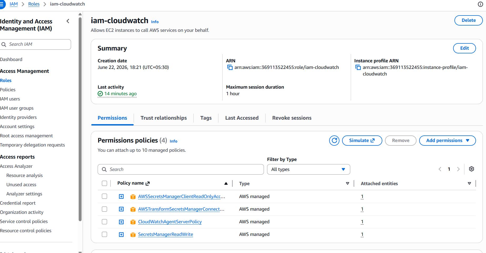

**AWS WAF**

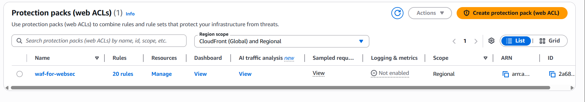

**Secrets Manager**

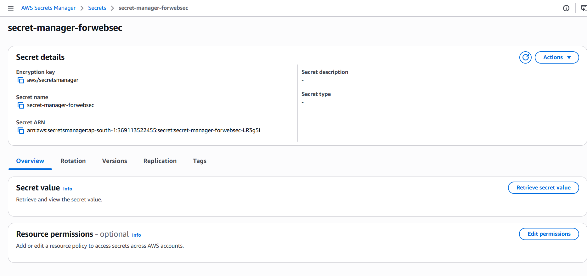

---

## Database Architecture

Amazon RDS for MySQL was deployed in private database subnets.

Security controls include:

- Private database deployment.

- Security Group restrictions.

- Database access limited to the web tier.

- Encryption at rest using AWS KMS.

- Multi-AZ deployment for availability.

Database communication uses TCP port 3306.

---

## Traffic Flow

### Application Request Flow

1. Client sends an HTTP request over the internet.

2. Traffic enters the VPC through the Internet Gateway.

3. AWS WAF inspects the incoming request through its association with the ALB.

4. The Application Load Balancer receives the request.

5. Traffic is forwarded to the registered Target Group.

6. An EC2 web server processes the request using IIS.

7. The web server communicates with Amazon RDS MySQL when required.

8. The response is returned to the client.

### Administrative Access Flow

1. Administrator connects to the Bastion Host using RDP.

2. Access is restricted to the administrator's authorized public IP.

3. The administrator connects to private web servers through the Bastion Host.

---

## Monitoring and Logging

Monitoring and audit logging provide visibility into infrastructure

health and AWS account activity.

### Amazon CloudWatch

Used for infrastructure monitoring and CPU utilization alarms.

### Amazon SNS

Configured to send email notifications when CloudWatch alarms are triggered.

### AWS CloudTrail

Records AWS account API activity for auditing and investigation.

### Amazon S3

Stores CloudTrail audit logs.

### Monitoring Evidence

**CloudTrail**

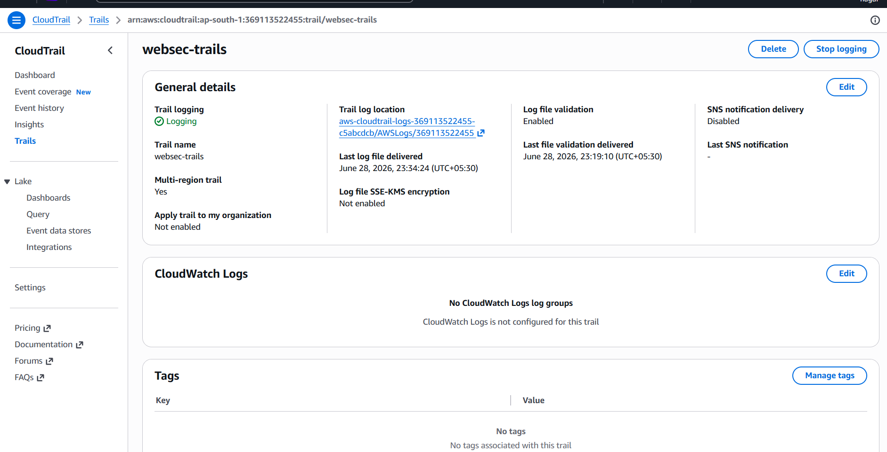

**CloudWatch**

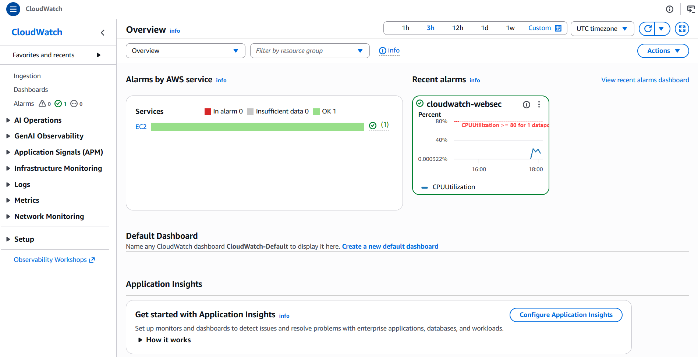

**SNS Notifications**

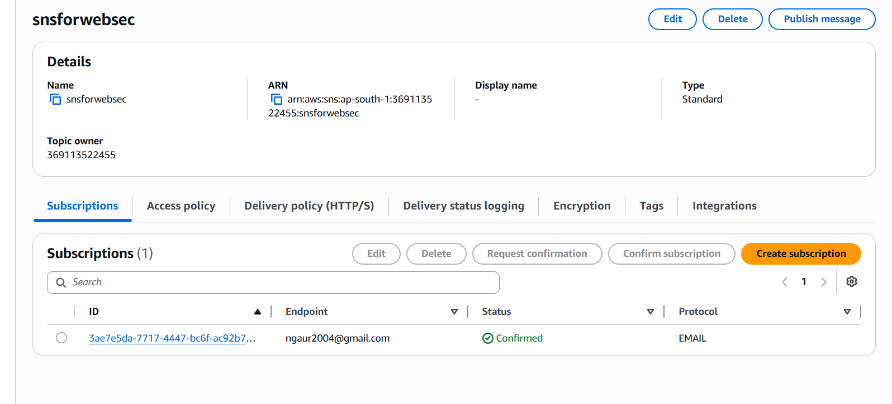

---

## Security Best Practices Applied

| Security Control | Implementation |

|---|---|

| Network Segmentation | Separate public, web and database subnets |

| Least Privilege | Dedicated IAM roles and restricted Security Groups |

| Credential Protection | AWS Secrets Manager |

| Web Application Protection | AWS WAF |

| Encryption at Rest | AWS KMS |

| Database Isolation | Private RDS deployment |

| Audit Logging | AWS CloudTrail |

| Infrastructure Monitoring | CloudWatch |

| Alerting | Amazon SNS |

| High Availability | Multi-AZ deployment and Auto Scaling |

| Administrative Access | Bastion Host |

---

## Challenges Faced

During implementation, I worked through several practical AWS

infrastructure and security challenges:

- Understanding route table behavior across public and private subnets.

- Configuring Security Groups to restrict communication between tiers.

- Implementing IAM permissions without unnecessary access.

- Configuring Launch Templates using a custom Windows Server AMI.

- Understanding the relationship between load balancing and Auto Scaling.

- Managing database credentials securely.

---

## Skills Demonstrated

- AWS Cloud Architecture

- AWS IAM and Access Management

- VPC and Network Segmentation

- EC2 and Windows Server Administration

- IIS Web Server Deployment

- Application Load Balancing

- Auto Scaling

- AWS WAF

- Amazon RDS

- AWS Secrets Manager

- AWS KMS Encryption

- CloudWatch Monitoring

- CloudTrail Auditing

- Security Group Configuration

- Cloud Security Best Practices

- Infrastructure Documentation

---

## Future Improvements

- [ ] Implement HTTPS using AWS Certificate Manager (ACM).

- [ ] Replace Bastion Host access with AWS Systems Manager Session Manager.

- [ ] Enable AWS Config for compliance monitoring.

- [ ] Integrate Amazon GuardDuty for threat detection.

- [ ] Enable VPC Flow Logs.

- [ ] Implement Infrastructure as Code using Terraform.

- [ ] Implement more granular IAM permissions.

- [ ] Introduce automated security validation.

- [ ] Implement a CI/CD pipeline.

---

## Project Documentation

The complete project documentation, including implementation

details and supporting evidence, is available below.

[**View Complete Project Documentation (PDF)**](docs/reports/AWS_Secure_Web_Application_Deployment.pdf)

---

## Author

**Naman Gaur**

M.Sc. Cybersecurity \& Digital Forensics

Cloud Security | IAM | Network Security

[LinkedIn](https://www.linkedin.com/in/naman-gaur-21322b294/)

[GitHub](https://github.com/ngaur10)

---

&#x20; <strong>Built as a hands-on AWS Cloud Security Engineering Project.</strong>

